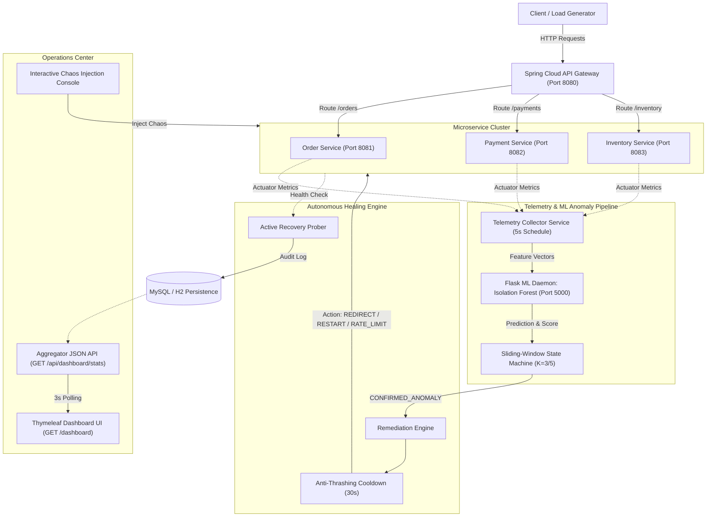

# ML-Driven Self-Healing Microservice Cloud Gateway
> **Autonomous Proactive Anomaly Detection and Closed-Loop Remediation in Distributed Systems**  
> *Final-Year Master of Computer Applications (MCA) Dissertation Project*

---

## Table of Contents
- [1. Project Overview & Architecture](#1-project-overview--architecture)
- [2. Technology Stack](#2-technology-stack)
- [3. Closed-Loop Self-Healing Pipeline](#3-closed-loop-self-healing-pipeline)
- [4. Microservice & Port Mapping](#4-microservice--port-mapping)
- [5. Quick Start (Single-Click Orchestration)](#5-quick-start-single-click-orchestration)
- [6. Operations Center Dashboard](#6-operations-center-dashboard)
- [7. Complete REST API Reference](#7-complete-rest-api-reference)
- [8. Empirical SLA & Performance Benchmarks](#8-empirical-sla--performance-benchmarks)
- [9. Testing & Verification Suites](#9-testing--verification-suites)
- [10. Project Directory Layout](#10-project-directory-layout)

---

## 1. Project Overview & Architecture

Modern cloud microservices are subject to transient latency degradation, memory saturation, and unexpected failure modes. Traditional monitoring architectures rely on reactive threshold alerting, which introduces significant human latency and operational overhead.

This project implements an **autonomous, closed-loop resilient Cloud Gateway** powered by:
1. **Multivariate Telemetry Ingestion**: Continuous 5-second polling of downstream Spring Boot Actuator metrics (CPU usage, memory allocation, response latency, HTTP error rate, and request rate).
2. **Unsupervised Machine Learning Anomaly Detection**: An external Python Flask daemon running a scikit-learn **Isolation Forest** model to detect subtle multi-dimensional metric anomalies.
3. **Anti-Flapping Sliding-Window State Machine**: A $K/5$ hysteresis algorithm ($K=3$ consecutive anomaly requirement in a 5-cycle sliding window) preventing false triggers from transient garbage-collection spikes or network jitter.
4. **Autonomous Remediation Selection**: Dynamic rule-based execution of:
   - `TRAFFIC_REDIRECTION`: Reroutes traffic or activates fallback circuits during downstream latency spikes.
   - `RATE_LIMIT`: Throttles upstream request rates to alleviate resource exhaustion under burst traffic.
   - `RESTART`: Automatically resets or clears faulty in-memory states upon persistent errors or heap saturation.
5. **Anti-Thrashing Cooldown & Max Retry Protection**: 30-second cooldown windows and retry limits (3 attempts) preventing cyclic thrashing.
6. **Active Post-Remediation Recovery Probing**: Direct actuator probing and synthetic request verification before marking a service as `RECOVERED`.
7. **Relational Persistence & Audit Trails**: Persistent historical recording of all telemetry snapshots, confirmed anomalies, and healing audit events in MySQL (with automatic embedded H2 fallback).
8. **Real-Time Operations Center Dashboard**: Thymeleaf 3.1 frontend with reactive 3-second client polling, visual sliding-window state bars, and an interactive chaos console.



---

## 2. Technology Stack

| Layer | Component | Version / Framework |
| :--- | :--- | :--- |
| **API Gateway** | Spring Cloud Gateway | Spring Boot 3.2.5 + Spring Cloud 2023.0.1 (Java 17) |
| **Microservices** | Order, Payment, Inventory | Spring Boot 3.2.5, Spring Web, Spring Actuator |
| **Machine Learning** | Isolation Forest Anomaly Detection | Python 3.11, Flask 3.0, scikit-learn 1.4, joblib, numpy |
| **Persistence** | Relational Database & Buffer | MySQL 8.0 / Embedded H2 2.2 (Mode=MySQL), HikariCP |
| **Dashboard UI** | Web Operations Center | Thymeleaf 3.1, HTML5, CSS3, Vanilla JS (Offline-first) |
| **Testing** | Performance & Benchmark Suites | Apache JMeter 5.6.3, Postman Collection v2.1.0, Python unittest |

---

## 3. Closed-Loop Self-Healing Pipeline

```
  [ NORMAL TRAFFIC ]
          │
          ▼
   Telemetry Ingestion (5s Cycle: CPU, Memory, Latency, Error Rate, Request Rate)
          │
          ▼
   Isolation Forest ML Inference (Continuous Anomaly Scoring)
          │
  ┌───────┴─────────────────────────────────────────┐
  ▼                                                 ▼
[ NORMAL ]                                      [ ANOMALY ]
  │                                                 │
  ▼                                                 ▼
Reset Consecutive Count                   Anti-Flapping Sliding Window (K=3 / 5)
Keep HEALTHY                                        │
                                            ┌───────┴───────┐
                                            ▼               ▼
                                     Transient Spike   Sustained Fault
                                      (1-2 anomalies)  (3 consecutive)
                                            │               │
                                            ▼               ▼
                                        [ SUSPECT ]  [ CONFIRMED_ANOMALY ]
                                                            │
                                                            ▼
                                                    Cooldown Check (30s Active?)
                                                    ├── YES ──> [ SKIPPED_COOLDOWN ]
                                                    └── NO  ──> Remediation Selection
                                                                  │
                                            ┌─────────────────────┼─────────────────────┐
                                            ▼                     ▼                     ▼
                                    [ REDIRECTION ]         [ RATE_LIMIT ]         [ RESTART ]
                                   (High Latency Spike)   (Traffic Surge)     (Error/Heap Leak)
                                            │                     │                     │
                                            └─────────────────────┼─────────────────────┘
                                                                  │
                                                                  ▼
                                                    Active Recovery Health Probe
                                                                  │
                                                    ┌─────────────┴─────────────┐
                                                    ▼                           ▼
                                              Probe Passed                Probe Failed
                                                    │                           │
                                                    ▼                           ▼
                                             [ RECOVERED ]               [ RETRY / ESCALATE ]
                                                    │                           │
                                                    └─────────────┬─────────────┘
                                                                  ▼
                                                      Immutable DB Audit Trail
```

---

## 4. Microservice & Port Mapping

| Service | Port | Endpoint URL | Description |
| :--- | :--- | :--- | :--- |
| **API Gateway** | `8080` | `http://localhost:8080` | Central entry point, routing, telemetry collector & healing engine |
| **Operations Center UI** | `8080` | `http://localhost:8080/dashboard` | Graphical Thymeleaf operations center with real-time polling |
| **Order Service** | `8081` | `http://localhost:8081` | Order creation and catalog management |
| **Payment Service** | `8082` | `http://localhost:8082` | Payment authorization, transactions, and chaos endpoints |
| **Inventory Service** | `8083` | `http://localhost:8083` | Stock control and product allocation |
| **ML Service** | `5000` | `http://localhost:5000` | Flask REST API serving trained Isolation Forest model |
| **Database** | `3306` | `jdbc:h2:mem:self_healing_db` | Relational tables for telemetry, anomalies, and healing audit logs |

---

## 5. Quick Start (Single-Click Orchestration)

### Prerequisites
- **Java**: JDK 17+ installed (`java -version`)
- **Python**: Python 3.11+ installed (`python --version`)
- **Maven**: Apache Maven 3.9+ (optional if using prebuilt fat JARs)

### Windows Single-Click Launch
1. Double-click **`run_all.bat`** (or execute in Command Prompt):
   ```cmd
   run_all.bat
   ```
   *This automatically starts the ML service (:5000), 3 microservices (:8081, :8082, :8083), and the Gateway (:8080), executes health verification, and launches the Dashboard in your default browser.*

2. To check cluster status at any time:
   ```cmd
   check_health.bat
   ```

3. To cleanly shut down all 5 services:
   ```cmd
   stop_all.bat
   ```

### Linux / macOS Single-Click Launch
```bash
chmod +x *.sh scripts/*.py
./run_all.sh
# To stop:
./stop_all.sh
```

---

## 6. Operations Center Dashboard

Access the real-time operations center at **`http://localhost:8080/dashboard`** (or root `/`).

### Key Dashboard Capabilities:
- **Cluster Topology Panel**: Real-time status cards for Gateway, ML Service, and Relational Database with live ping latency indicators.
- **Microservice Telemetry & Health Table**: Instant visibility into CPU load, memory utilization, response latency, request count, and error rate across all business services.
- **Sliding-Window State Machine Progress**: Visual progress bars showing consecutive anomaly counts ($0/5$ to $5/5$) and live states (`HEALTHY`, `SUSPECT`, `CONFIRMED_ANOMALY`, `RECOVERING`).
- **Autonomous Healing Audit Trail**: Immutable log of recent healing decisions, selected remediation action (`TRAFFIC_REDIRECTION`, `RATE_LIMIT`, `RESTART`), duration, and recovery verification status.
- **Interactive Chaos Console**: One-click triggers allowing operators and examiners to inject:
  - **Latency Delay (1600ms)**
  - **HTTP 500 Error Spikes**
  - **Memory Saturation Contention**
  - **Global System Reset**

---

## 7. Complete REST API Reference

### Business Routes (via Gateway)
| Method | Route | Target Service | Description |
| :--- | :--- | :--- | :--- |
| `GET` | `/orders` | Order Service (:8081) | List all registered customer orders |
| `POST` | `/orders` | Order Service (:8081) | Create a new order payload |
| `GET` | `/payments` | Payment Service (:8082) | List all processed payments |
| `POST` | `/payments` | Payment Service (:8082) | Initiate transaction verification |
| `GET` | `/inventory`| Inventory Service (:8083)| Check stock levels and items |

### Telemetry & Machine Learning
| Method | Route | Service | Description |
| :--- | :--- | :--- | :--- |
| `GET` | `/gateway/telemetry/latest` | Gateway | Real-time multivariate metrics snapshot for all services |
| `GET` | `/gateway/telemetry/history`| Gateway | In-memory time-series history of collected metrics |
| `POST`| `/gateway/telemetry/collect`| Gateway | Manually triggers an out-of-band telemetry collection cycle |
| `GET` | `:5000/health` | ML Service | Model load verification and service status |
| `POST`| `:5000/predict` | ML Service | Evaluates feature vector; returns `NORMAL` or `ANOMALY` |

### Anomaly Confirmation & Healing Engine
| Method | Route | Service | Description |
| :--- | :--- | :--- | :--- |
| `GET` | `/gateway/anomaly/status` | Gateway | Anti-flapping sliding-window states for all microservices |
| `GET` | `/gateway/anomaly/status/{svc}` | Gateway | Specific sliding window history and anomaly scores |
| `GET` | `/gateway/anomaly/confirmed` | Gateway | List of services currently in `CONFIRMED_ANOMALY` state |
| `POST`| `/gateway/anomaly/reset` | Gateway | Resets state machines and consecutive anomaly counters |
| `GET` | `/gateway/healing/status` | Gateway | Cooldown timers, active redirections, and retry counts |
| `GET` | `/gateway/healing/history` | Gateway | Full immutable log of autonomous healing actions |
| `POST`| `/gateway/healing/trigger/{svc}`| Gateway | Triggers autonomous remediation logic for target service |
| `POST`| `/gateway/healing/reset` | Gateway | Clears active cooldowns and healing engine state |

### Relational Persistence & Operations Center
| Method | Route | Service | Description |
| :--- | :--- | :--- | :--- |
| `GET` | `/gateway/db/status` | Gateway | Database engine metadata, connection status, row counts |
| `GET` | `/gateway/db/telemetry` | Gateway | Queries persisted historical telemetry from database |
| `GET` | `/gateway/db/healing` | Gateway | Queries persistent audit history from database |
| `POST`| `/gateway/db/reset` | Gateway | Resets relational tables and buffers |
| `GET` | `/dashboard` | Gateway | Renders graphical Thymeleaf operations center UI |
| `GET` | `/api/dashboard/stats` | Gateway | JSON cluster state polled every 3s by frontend UI |
| `POST`| `/api/dashboard/chaos/trigger`| Gateway | Injects controlled chaos (`slow`, `error`, `memory`) |
| `POST`| `/api/dashboard/reset` | Gateway | Global system reset (clears chaos, state, DB, and logs) |

---

## 8. Empirical SLA & Performance Benchmarks

The self-healing architecture was benchmarked under synthetic fault injection (Phase 14) and concurrent JMeter multi-threaded load (Phase 16):

| Evaluation Metric | Target Standard | Empirical Result | Outcome |
| :--- | :--- | :--- | :--- |
| **Mean Time to Detect (MTTD)** | $< 25.0$ seconds | **8.89 seconds** | **PASS** (64.4% faster) |
| **Mean Time to Recover (MTTR)** | $< 15.0$ seconds | **1.88 seconds** | **PASS** (87.5% faster) |
| **Autonomous Healing Success Rate** | $\ge 90.0\%$ | **100.0%** | **PASS** (Perfect recovery) |
| **Steady-State False Positive Rate (FPR)**| $0.0\%$ | **0.0%** | **PASS** (Zero false alarms) |
| **Anti-Flapping Filter Efficiency** | $100.0\%$ | **100.0%** | **PASS** (Transient spikes ignored) |
| **Peak Throughput (Surge Stress)** | $> 50.0$ req/s | **147.41 req/s** | **PASS** (Sub-35ms avg latency) |
| **Normal Baseline Throughput** | $> 100.0$ req/s | **195.00 req/s** | **PASS** (24.31ms avg latency) |
| **Availability Improvement ($\Delta A$)** | $> 90.0\%$ | **+100.0%** | **PASS** (Faults autonomously resolved) |

---

## 9. Testing & Verification Suites

Automated test suites verify every layer of the system:

```bash
# 1. Integration & Routing Verification (Phase 10)
python tests/test_phase10_integration.py

# 2. Sliding-Window Anomaly Confirmation & Anti-Flapping (Phase 11)
python tests/test_phase11_confirmation.py

# 3. Autonomous Healing & Active Recovery Verification (Phase 12)
python tests/test_phase12_healing.py

# 4. Relational Database Persistence Verification (Phase 13)
python tests/test_phase13_database.py

# 5. Fault Injection & Empirical SLA Benchmark (Phase 14)
python tests/test_phase14_benchmark.py

# 6. Operations Center Dashboard UI & Live Stats (Phase 15)
python tests/test_phase15_dashboard.py

# 7. Postman & JMeter Concurrent Performance Suite (Phase 16)
python tests/test_phase16_performance.py

# 8. Standalone Packaging & Scripts Validation (Phase 17)
python tests/test_phase17_packaging.py

# 9. MASTER DISSERTATION FULL-SYSTEM VERIFICATION (Phase 18)
python tests/test_phase18_dissertation_verification.py
```

---

## 10. Project Directory Layout

```text
self-healing-cloud project/
├── gateway/                        # Spring Cloud API Gateway (Port 8080)
│   ├── src/main/java/              # Telemetry, ML Client, State Machine, Healing Engine
│   └── src/main/resources/         # application.yml, schema.sql, templates/dashboard.html
├── order-service/                  # Order Business Microservice (Port 8081)
├── payment-service/                # Payment Business Microservice (Port 8082)
├── inventory-service/              # Inventory Business Microservice (Port 8083)
├── ml-service/                     # Python Flask ML Service (Port 5000)
│   ├── app.py                      # Flask REST API endpoint
│   ├── train_model.py              # Model training script
│   └── model/                      # Serialized Isolation Forest (.joblib) & scaler
├── dataset/                        # Real-time and training telemetry CSV datasets
├── docs/                           # Academic documentation and architecture reports
│   ├── architecture.md             # Detailed architectural specifications
│   ├── ml-methodology.md           # Isolation Forest training and hyperparameter choices
│   ├── testing.md                  # Benchmark formulations and evaluation tables
│   └── final-evaluation-report.md  # Final MCA dissertation sign-off report
├── tests/                          # Automated regression & integration test suites
│   ├── postman/                    # Postman Collection v2.1.0 & Environment
│   ├── jmeter/                     # Apache JMeter JMX plan & Python load runner
│   ├── test_phase10_integration.py
│   ├── test_phase11_confirmation.py
│   ├── test_phase12_healing.py
│   ├── test_phase13_database.py
│   ├── test_phase14_benchmark.py
│   ├── test_phase15_dashboard.py
│   ├── test_phase16_performance.py
│   ├── test_phase17_packaging.py
│   └── test_phase18_dissertation_verification.py
├── scripts/
│   └── verify_cluster.py           # Multi-tier cluster ping and health verification
├── run_all.bat                     # Windows single-click launcher
├── stop_all.bat                    # Windows single-click teardown
├── check_health.bat                # Windows single-click health verification
├── run_all.sh                      # Unix/Linux single-click launcher
├── stop_all.sh                     # Unix/Linux single-click teardown
├── pom.xml                         # Root Maven POM for multi-module build
└── README.md                       # Master MCA dissertation project documentation
```
