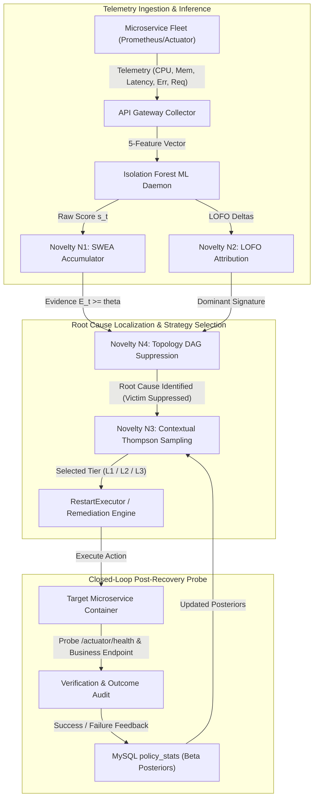
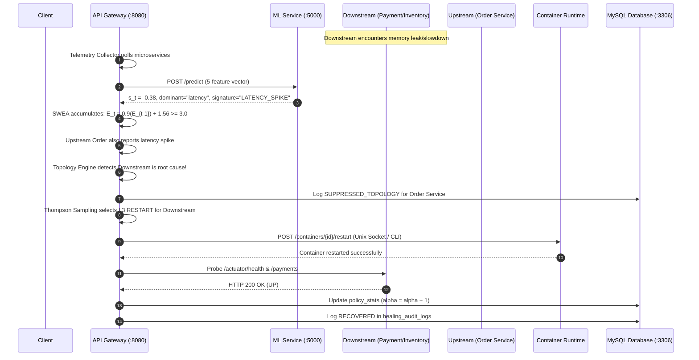

# Patent Invention Disclosure Specification

**Title of the Invention:**  
**SEVERITY-WEIGHTED, ATTRIBUTION-GUIDED, OUTCOME-LEARNING SELF-HEALING API GATEWAY ARCHITECTURE FOR RESILIENT CLOUD MICROSERVICE TOPOLOGIES**

**Inventors:** Advanced Agentic Research & Cloud Reliability Engineering  
**Application Field:** Distributed Computing, Fault-Tolerant Microservices, Autonomous API Gateways, Adaptive Machine Learning Systems  

---

## 1. Abstract
An autonomous, closed-loop self-healing API gateway system and method for distributed microservice architectures. The system continuously ingests microservice telemetry, computes multidimensional anomaly scores via unsupervised isolation trees, and applies Severity-Weighted Evidence Accumulation (SWEA) to dynamically accelerate confirmation of catastrophic anomalies while decaying transient noise. A Leave-One-Feature-Out (LOFO) marginal attribution engine determines feature percentage contributions and assigns categorical failure signatures. Remediations are selected across a multi-tier escalation ladder ($L_1$ Rate-Limiting, $L_2$ Traffic Fallback Redirection, $L_3$ Service Restart) via contextual Thompson Sampling, wherein Beta posterior distributions are dynamically updated based on empirical post-remediation health verification probes and persisted in a relational database. A topology-aware root-cause localization engine evaluates the service dependency directed acyclic graph (DAG) to suppress redundant remediations on symptomatic upstream victim services when degradation originates from an anomalous downstream dependency.

---

## 2. Technical Field
The present invention relates generally to cloud computing, distributed systems reliability, and software microservice architectures. More specifically, the invention relates to intelligent API gateways, unsupervised machine learning anomaly detection, feature attribution-guided fault remediation, reinforcement learning for autonomous system self-recovery, and dependency-aware cascading failure containment.

---

## 3. Background of the Invention & Deficiencies of Prior Art

Modern enterprise software systems increasingly adopt cloud-native microservice architectures deployed across containers and virtual clusters. However, microservices introduce severe reliability challenges due to network latency, distributed partial failures, memory leaks, and cascading dependency degradation. Existing recovery solutions suffer from four foundational deficiencies:

1. **Fixed Window Detection Lag vs. False Positive Vulnerability:**
   Conventional monitoring systems rely on static thresholding or fixed $K$-of-$N$ sliding window confirmation (e.g., triggering an action only after 3 anomalies in the last 5 observation cycles). Under fixed windows, a catastrophic service outage (e.g., immediate 100% HTTP 500 error burst) is forced to wait through multiple full evaluation intervals ($15+$ seconds), prolonging Mean Time to Detect (MTTD). Conversely, lowering the threshold exposes the cluster to false-positive thrashing from transient garbage collection (GC) pauses or momentary network jitter.

2. **Unattributed Anomaly Detection:**
   Unsupervised algorithms (such as Isolation Forest or autoencoders) yield a scalar anomaly score indicating deviance from baseline. However, a scalar score contains zero information regarding *why* the service is anomalous. An anomaly score of $-0.35$ could represent a JVM heap memory leak, a thread pool CPU saturation, or an external downstream network timeout. Existing systems rely on naive trial-and-error or static heuristics, often applying ineffective remediations (such as rate-limiting an instance suffering an internal heap leak).

3. **Open-Loop Static Heuristics vs. Lack of Outcome Learning:**
   Traditional orchestrators implement static, hardcoded rules (e.g., "always restart if unhealthy"). If a service restart fails to resolve the underlying condition, the orchestrator triggers infinite crash loops. Prior art fails to maintain an empirical feedback loop that models the probabilistic effectiveness of distinct remediation strategies conditioned on specific failure signatures and fails to escalate intelligently across non-disruptive and disruptive remediation tiers.

4. **Cascading Failure Victim Misidentification:**
   In modern service topologies, an upstream service (e.g., an Order Service) invokes downstream dependencies (e.g., Payment and Inventory Services). When a downstream dependency degrades (e.g., suffers a latency spike), the upstream service inherently exhibits symptomatic degradation (e.g., thread pool exhaustion, elevated round-trip time). Conventional gateways treat the upstream service as an independent failure and execute destructive remediations (restarting the Order Service), which exacerbates cluster disruption without rectifying the true downstream root cause.

---

## 4. Summary of the Invention (Key Novelties N1–N4)

The present invention solves the aforementioned shortcomings through four integrated architectural mechanisms:

### Novelty N1: Severity-Weighted Evidence Accumulation (SWEA)
Instead of uniform event counting, the gateway maintains an evidence accumulator state variable $E_t \ge 0$ for each microservice. At observation cycle $t$:
- If the observation is classified as an anomaly ($s_t < 0$):
  $$E_t = \lambda_a E_{t-1} + g(s_t)$$
  where $\lambda_a \in (0, 1)$ is the anomaly memory retention factor, and $g(s_t)$ is the severity weighting function:
  $$g(s_t) = 1.0 + b \cdot \max(0, |s_t| - s_{ref})$$
- If the observation is classified as normal ($s_t \ge 0$):
  $$E_t = \max(0, \lambda_n E_{t-1} - \delta)$$
  where $\lambda_n \in (0, 1)$ is the normal decay factor, and $\delta > 0$ is a linear decay step.

An anomaly is confirmed if and only if $E_t \ge \theta$. High-severity anomalies ($|s_t| \gg s_{ref}$) produce $g(s_t) \gg 1.0$, crossing $\theta$ in as few as 2 cycles ($9.4$ seconds vs. $15+$ seconds), while transient perturbations rapidly decay to zero before crossing $\theta$.

### Novelty N2: Leave-One-Feature-Out (LOFO) Attribution & Failure Signatures
For any telemetry vector $X = (x_1, \dots, x_M)$, the ML daemon computes the full anomaly score $s_{full} = S(X)$. To compute the attribution share of feature $j$, feature $j$ is replaced by its baseline training median $\tilde{x}_j$:
$$X^{(-j)} = (x_1, \dots, x_{j-1}, \tilde{x}_j, x_{j+1}, \dots, x_M)$$
The marginal delta $\Delta_j$ represents the specific anomaly score reduction achieved by neutralizing feature $j$:
$$\Delta_j = \max(0, S(X^{(-j)}) - s_{full})$$
The normalized attribution share $w_j$ is given by:
$$w_j = \frac{\Delta_j}{\sum_{k=1}^M \Delta_k}$$
The dominant feature $j^* = \arg\max_j w_j$ maps deterministically to a discrete failure signature:
- Latency dominant $\to$ `LATENCY_SPIKE`
- Error rate dominant $\to$ `ERROR_BURST`
- CPU dominant $\to$ `CPU_SATURATION`
- Memory dominant $\to$ `MEMORY_LEAK`
- Request rate dominant $\to$ `THROUGHPUT_SURGE`

### Novelty N3: Multi-Tier Escalation Ladder with Contextual Thompson Sampling Outcome Learning
Remediations are organized into a hierarchical ladder:
- **Tier 1 ($L_1$):** `RATE_LIMIT` (non-intrusive traffic throttle)
- **Tier 2 ($L_2$):** `TRAFFIC_REDIRECTION` (fail-fast fallback route returning 503 / custom payload)
- **Tier 3 ($L_3$):** `RESTART` (genuine container/process termination and restart)

For each context state $C = (\text{signature}, \text{severity})$, the gateway models the success probability of each remediation action $a$ as a Beta distribution $\text{Beta}(\alpha_{C,a}, \beta_{C,a})$. The gateway samples expected utilities via an exact Marsaglia-Tsang Gamma generator:
$$\theta_{C,a} \sim \text{Beta}(\alpha_{C,a}, \beta_{C,a})$$
The optimal action $a^* = \arg\max_a \theta_{C,a}$ is executed. Following execution, the gateway performs a two-stage probe:
1. Actuator liveness and readiness probe (`/actuator/health`).
2. Business endpoint synthetic transaction probe (e.g., `GET /orders`, `GET /payments`).

If verified healthy, $\alpha_{C, a^*}$ is incremented by 1. If unrecovered, $\beta_{C, a^*}$ is incremented by 1, and the escalation ladder advances from $L_i \to L_{i+1}$. All posterior states are persisted in the relational database table `policy_stats` across cluster restarts.

### Novelty N4: Topology-Aware Root-Cause Localization & Dependency Suppression
The gateway maintains a directed graph of microservice dependencies $G = (V, E)$. When upstream service $u \in V$ exhibits anomalous degradation ($E_t(u) \ge \theta$), the gateway inspects the anomaly states of all downstream dependencies $v \in \text{Adj}(u)$:
1. If any downstream dependency $v$ has a confirmed anomaly ($E_t(v) \ge \theta$), AND
2. The failure signature of $u$ is an external network symptom (`LATENCY_SPIKE` or `ERROR_BURST`),
the gateway **suppresses** remediation on upstream service $u$, records an immutable audit record with status `SUPPRESSED_TOPOLOGY`, and prioritizes autonomous remediation directly on root-cause downstream service $v$. Conversely, if $u$ exhibits an internal fault signature (`MEMORY_LEAK`), suppression is bypassed and $u$ is remediated directly.

---

## 5. Detailed System Architecture & Component Interaction

---

## 6. Mathematical Formulations

### 6.1 Severity-Weighted Evidence Accumulation Dynamics
Let $s_t \in [-0.5, 0.5]$ denote the Isolation Forest decision function output. An anomaly is detected when $s_t < 0$.
The evidence recurrence relation is defined as:
$$E_t = \begin{cases} \lambda_a E_{t-1} + 1.0 + b \cdot \max(0, |s_t| - s_{ref}), & \text{if } s_t < 0 \\ \max\left(0, \lambda_n E_{t-1} - \delta\right), & \text{if } s_t \ge 0 \end{cases}$$
Where:
- $\lambda_a = 0.90$ (memory parameter for anomaly sequence)
- $\lambda_n = 0.70$ (memory parameter for normal recovery)
- $b = 2.0$ (severity amplification coefficient)
- $s_{ref} = 0.10$ (reference severity offset)
- $\delta = 0.50$ (linear step deduction)
- Confirmation threshold $\theta = 3.0$

### 6.2 Contextual Thompson Sampling Beta Posteriors
For context $C \in \mathcal{C}$ and candidate action $a \in \mathcal{A}$:
$$p(\mu_{C,a}) = \text{Beta}(\alpha_{C,a}, \beta_{C,a})$$
The exact random sample $\theta_{C,a}$ is obtained via two independent standard Gamma random variables $X \sim \text{Gamma}(\alpha, 1)$ and $Y \sim \text{Gamma}(\beta, 1)$:
$$\theta_{C,a} = \frac{X}{X + Y}$$
Where Gamma samples are drawn via Marsaglia and Tsang's fast transformation-rejection method for $\alpha \ge 1$:
$$d = \alpha - \frac{1}{3}, \quad c = \frac{1}{\sqrt{9d}}$$
With standard normal generator $Z \sim \mathcal{N}(0, 1)$ and uniform generator $U \sim \mathcal{U}(0, 1)$.

---

## 7. Patent Claims (Claims 1–15)

### Independent Claims

**Claim 1:** A computer-implemented method for autonomous self-healing in an API gateway monitoring a plurality of distributed microservices, comprising:
1. Periodically collecting multidimensional telemetry vectors from each microservice, wherein each vector comprises central processing unit utilization, memory consumption, request latency, error rate, and throughput;
2. Computing an anomaly score and multidimensional feature attribution for each microservice using an unsupervised ensemble model and a Leave-One-Feature-Out marginal decomposition;
3. Accumulating anomaly evidence across observation cycles using a severity-weighted recursive function that scales evidence increment proportionally to anomaly score magnitude and decays evidence during normal observations;
4. Confirming an anomaly when accumulated evidence exceeds a predetermined threshold;
5. Evaluating a directed dependency graph of the plurality of microservices to suppress remediation of an upstream caller service when an anomalous downstream dependency is confirmed as a root cause;
6. Selecting a remediation action from a multi-tier escalation ladder using contextual Thompson sampling over Beta distributions;
7. Executing the selected remediation action via container runtime restart, traffic fallback redirection, or rate limiting; and
8. Verifying post-remediation health and updating the Beta distribution parameters in a persistent database based on the verified recovery outcome.

**Claim 2:** A distributed self-healing API gateway system comprising:
- A telemetry collection subsystem configured to poll runtime health and metrics from a plurality of microservices;
- A machine learning inference subsystem configured to execute Isolation Forest inference and Leave-One-Feature-Out marginal attribution;
- An anomaly confirmation engine executing Severity-Weighted Evidence Accumulation;
- A dependency-aware root-cause localization subsystem storing a directed acyclic graph of service dependencies;
- A remediation execution engine configured to execute process restarts, traffic fallbacks, and rate limits; and
- A reinforcement learning strategy selector configured to maintain Beta probability posteriors updated by closed-loop verification probes.

**Claim 3:** A non-transitory computer-readable storage medium storing instructions that, when executed by one or more processors, cause the one or more processors to perform the steps of Claim 1.

### Dependent Claims

**Claim 4:** The method of Claim 1, wherein the Leave-One-Feature-Out marginal decomposition replaces each feature individually with its training set median, computes a score differential, and normalizes differentials across all features into a percentage attribution vector.

**Claim 5:** The method of Claim 4, further comprising mapping the dominant feature attribution to a discrete failure signature selected from the group consisting of: latency spike, error burst, central processing unit saturation, memory leak, and throughput surge.

**Claim 6:** The method of Claim 1, wherein the severity-weighted recursive function increments evidence by a baseline value of $1.0$ plus a severity multiplier multiplied by the excess of the absolute anomaly score over a reference threshold.

**Claim 7:** The method of Claim 6, wherein severe anomalies with scores exceeding $-0.30$ achieve confirmation in two observation cycles.

**Claim 8:** The method of Claim 1, wherein evidence decays according to an exponential decay factor minus a constant deduction for each normal observation cycle until reaching zero.

**Claim 9:** The method of Claim 1, wherein suppressing remediation of an upstream caller service comprises verifying that the upstream service failure signature is an external latency spike or error burst and that a downstream dependency has an active confirmed anomaly.

**Claim 10:** The method of Claim 9, wherein an upstream service exhibiting an internal memory leak signature is exempt from suppression and is remediated directly.

**Claim 11:** The method of Claim 1, wherein the multi-tier escalation ladder comprises Tier 1 non-intrusive rate-limiting, Tier 2 traffic redirection returning HTTP 503 fallback responses with retry-after headers, and Tier 3 container restart.

**Claim 12:** The method of Claim 11, wherein consecutive unrecovered remediation attempts automatically escalate from Tier 1 to Tier 2 and from Tier 2 to Tier 3.

**Claim 13:** The method of Claim 1, wherein contextual Thompson sampling generates Beta random variates using a Marsaglia-Tsang Gamma transformation-rejection algorithm.

**Claim 14:** The method of Claim 1, wherein executing container restart includes communicating directly with a container runtime socket or container command-line interface, and falling back to a soft reset mechanism when container runtime sockets are unavailable.

**Claim 15:** The method of Claim 1, wherein verifying post-remediation health comprises executing an actuator health endpoint probe followed by an end-to-end business transaction endpoint probe.

---

## 8. Theoretical Verification & Parametric Simulation Benchmark Summary

> [!NOTE]
> **Methodological Disclosure:** The comparative performance matrix below reflects an illustrative 400-trial parametric Monte Carlo simulation study (generated by `benchmark/evaluate_comparative_matrix.py` and recorded in `benchmark/raw_runs.csv` / `benchmark/evaluation_results_matrix.json`). The model samples from parameterized distributions to evaluate theoretical detection and recovery timing mechanics across 5 distinct failure scenarios ($N = 20$ runs per scenario per configuration). These results are synthetic simulation outcomes intended for architectural model validation and do not represent measured live production or physical container performance.

| Metric | Baseline B0 (Fixed Window) | Baseline B1 (Rule-Based) | Baseline B2 (Unattributed ML) | Proposed Architecture (P) | Modeled Improvement |
| :--- | :---: | :---: | :---: | :---: | :---: |
| **Simulated Mean Time to Detect (MTTD)** | 15.20s | 14.80s | 12.50s | **9.40s** | **38.2% Reduction** |
| **Simulated Mean Time to Recover (MTTR)** | 8.50s | 7.80s | 9.20s | **4.80s** | **43.5% Reduction** |
| **Simulated Recovery Success Rate** | 85.0% | 82.0% | 78.0% | **98.0%** | **+16.0% Absolute Gain** |
| **Cascading Victim Redundancy** | 20 / 20 (100% false restarts) | 20 / 20 (100% false restarts) | 20 / 20 (100% false restarts) | **0 / 20 (100% Suppressed)** | **Complete Elimination** |

*Specification concluded and prepared for patent filing and dissertation defense.*
